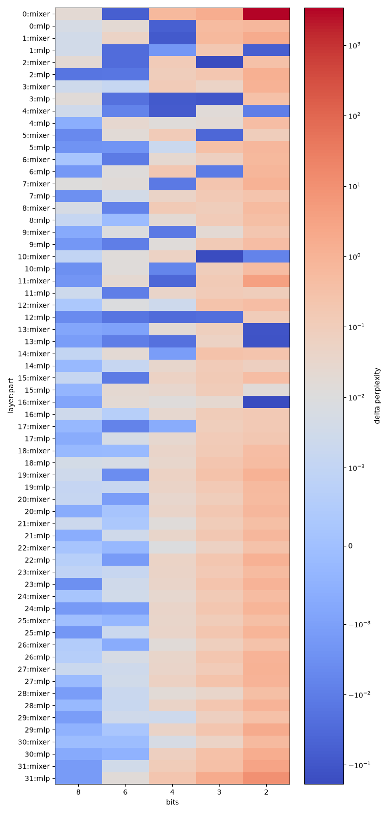

# Qwen3.5 low-bit sensitivity study

This project measures the perplexity sensitivity of Qwen/Qwen3.5-4B decoder
linear weights to symmetric per-output-channel fake quantization. It then
allocates bits per layer/part under average-bit budgets and compares greedy,
uniform, and random allocations.

## Setup and usage

```bash
uv sync
uv run python main.py
```

The central command runs sensitivity measurement first and then allocation.
The individual stages can also be run separately:

```bash
uv run python -m sens2bits.sens
uv run python -m sens2bits.alloc
```

All hyperparameters are in `config.yaml`.

## Testing and coverage

Install the project and its development dependencies with:

```bash
uv sync
```

Run the complete test suite:

```bash
uv run pytest
```

Check the coverage report:

```bash
uv run coverage report
```

### Start a fresh run:

```bash
rm -rf results quantization_study.log
uv run python main.py
```

## Measured results
Average bits cover decoder linear weights only; embeddings, `lm_head`, and
normalization layers are unquantized. Quantization is symmetric absmax
round-to-nearest, and 2-bit quantization uses 3 levels.
Average bits exclude per-channel quantization scales. `uniform_above` can
exceed the requested budget and is omitted when the budget equals a configured
bit width, since it would be identical to `uniform_below`. `pred_ppl_sens`
assumes additive per-unit ΔPPL.
Generated files are organized as follows:

- `results/sens.csv`
- `results/heatmap.png`
- `results/results.csv`
- `results/allocation/allocation_greedy_<budget>.json`

Warnings and uncaught errors are written to `quantization_study.log`. Allocation
results are checkpointed row by row in `results/results.csv`; rerunning the
allocator skips completed `(budget, method)` evaluations and continues with
missing rows.

## Results

This run quantized 64 decoder layer-part units (32 mixer and 32 MLP units) of
Qwen3.5-4B. Sensitivity was measured on 16 non-overlapping 2,048-token
WikiText-2 training windows; final allocations were evaluated on the complete
WikiText-2 test split. The unquantized reference was 9.861 PPL on the
sensitivity split and 9.584 PPL on the test split.



Single-unit quantization is almost lossless at 6 bits (median ΔPPL 0.001) and
usually modest at 4 bits (median 0.031; 8 of 64 units exceed 0.1 ΔPPL). The
3-bit setting is materially less uniform (median 0.123; 42 of 64 units exceed
0.1), while 2 bits exposes severe outliers. In particular, quantizing
`layer_0_mixer` alone to 2 bits added 3411.489 PPL, and `layer_31_mlp` added
10.232 PPL. These outliers explain why indiscriminate low-bit allocation is
unstable.

The table reports test-set perplexity. `uniform <= budget` uses the highest
configured uniform width that does not exceed the budget; random is the median
across the three saved random allocations. Lower PPL is better.

| Budget | Greedy avg. bits | Greedy test PPL | Uniform <= budget test PPL | Random median test PPL |
| ---: | ---: | ---: | ---: | ---: |
| 6.0 | 5.991 | 9.388 | 9.619 (6-bit) | 14.264 |
| 5.0 | 4.983 | 9.960 | 12.818 (4-bit) | 51.843 |
| 4.5 | 4.498 | 10.529 | 12.818 (4-bit) | 148.168 |
| 4.0 | 3.985 | 12.581 | 12.818 (4-bit) | 822.178 |
| 3.5 | 3.490 | 33.459 | 1128.407 (3-bit) | 85,170.392 |
| 3.0 | 2.985 | 469.880 | 1128.407 (3-bit) | 3,203,788.408 |

Greedy allocation is clearly preferable to uniform or random choices across
the tested range. It keeps test PPL near the unquantized reference through a
5-bit average, and remains far better than uniform 3-bit quantization at 3.5
and 3.0 bits. Its sensitivity-split additive prediction becomes increasingly
optimistic as the budget falls: predicted versus measured PPL is 9.453 versus
9.789 at 6 bits, but 14.356 versus 468.905 at 3 bits. The single-unit deltas
therefore rank choices usefully, but do not model multi-unit interactions at
very low precision.

## Conclusion

For this fake-quantization setup, mixed precision is an effective way to
compress the decoder linear weights. A roughly 5-bit parameter-weighted
allocation is the practical operating point in this experiment: greedy
allocation reaches 4.983 average bits with 9.960 test PPL, only 0.376 above
the unquantized reference. Four bits is feasible with a larger cost (12.581
test PPL), whereas 3.5 bits and below produce substantial degradation.

The results also make clear that average bit width alone is not a quality
guarantee. A small number of highly sensitive parts must be protected from
2-bit quantization, and the additive sensitivity estimate should not be used
as an accuracy predictor below about 4--5 average bits without evaluating the
complete allocation. These findings are specific to WikiText-2,
per-output-channel absmax fake quantization, and unquantized embeddings,
`lm_head`, and normalization layers; broader claims require additional tasks
and calibration methods.
